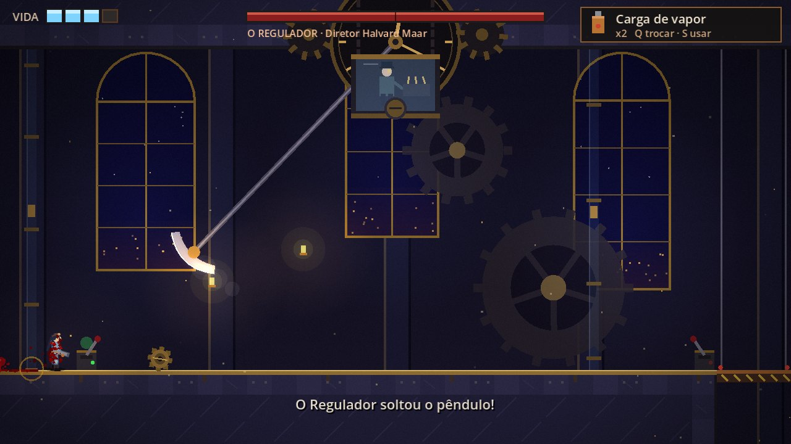
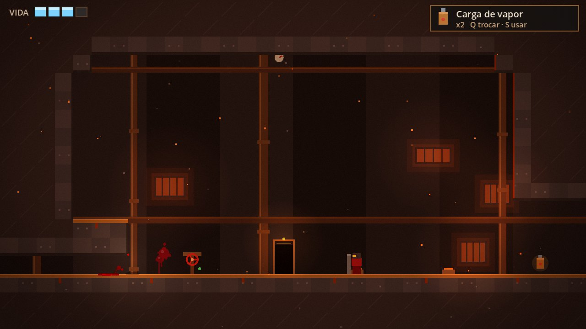
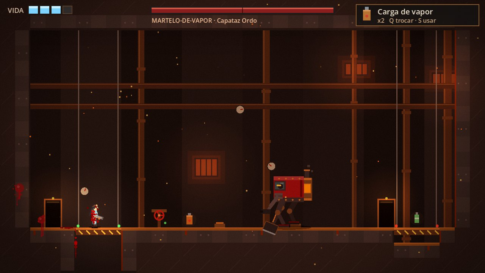
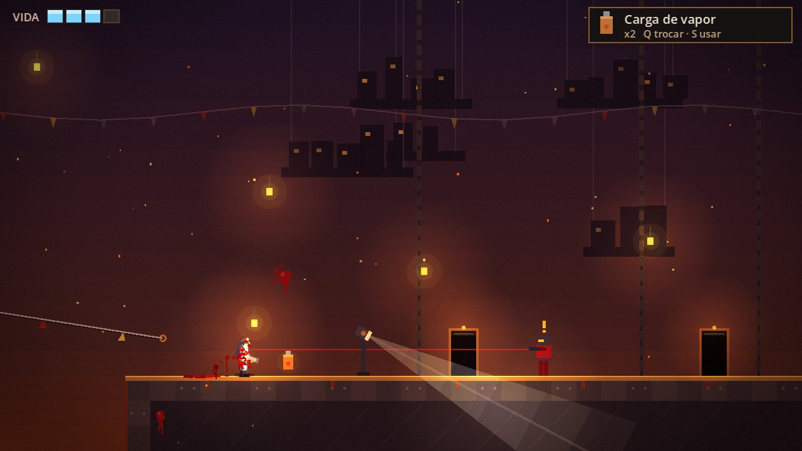
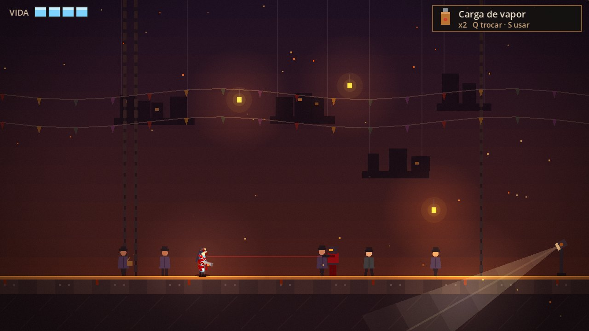
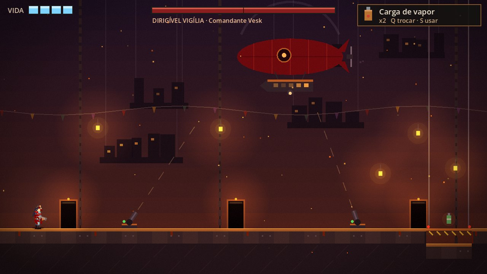
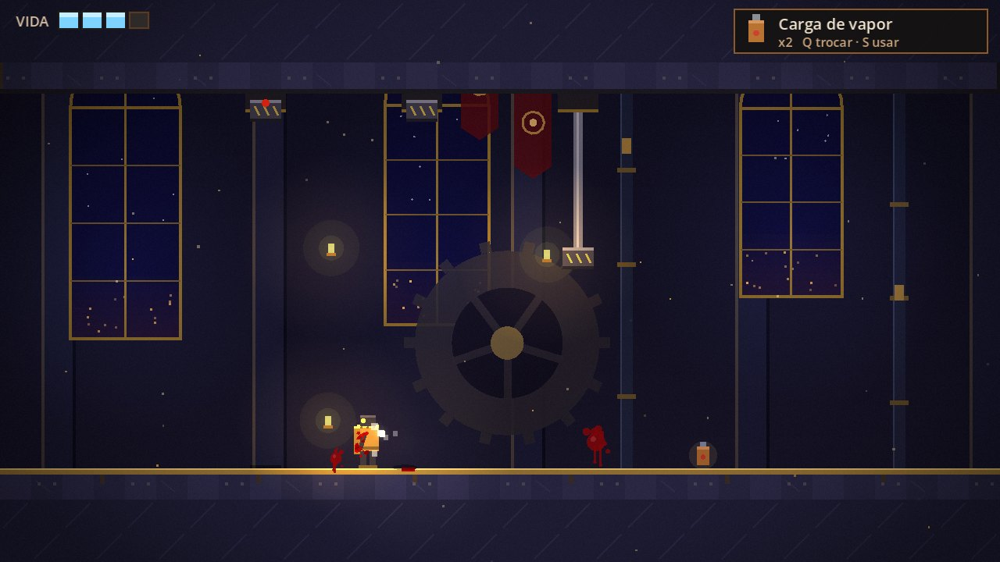
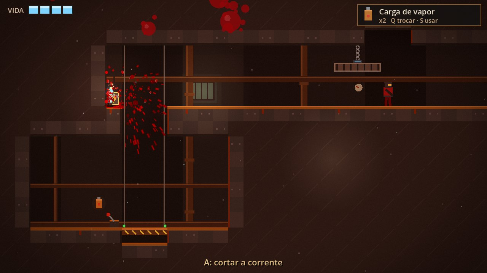
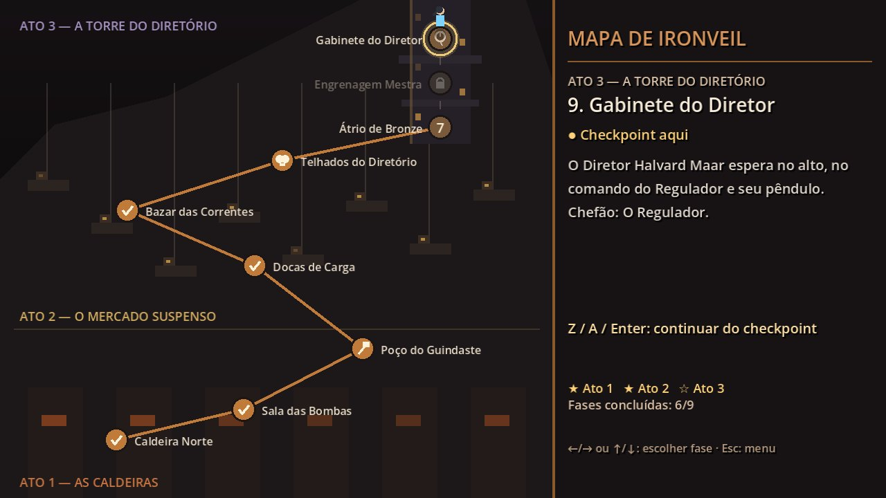

<div align="center">

# ⚙️ IRONVEIL

**Plataforma cinematográfico 2D em três atos — vapor, latão e uma conspiração no alto da Torre.**

[](https://github.com/igonozoid/ironveil/actions/workflows/build.yml)
[](https://github.com/igonozoid/ironveil/releases/latest)




### [⬇️ Baixar para Windows](https://github.com/igonozoid/ironveil/releases/latest) · [Linux](https://github.com/igonozoid/ironveil/releases/latest) · [macOS](https://github.com/igonozoid/ironveil/releases/latest) · [Android](https://github.com/igonozoid/ironveil/releases/latest)

</div>

---

## 📖 A história

**Ironveil** é uma cidade vertical lacrada dentro de uma montanha. Embaixo ficam as
**Caldeiras**, onde os operários mantêm a cidade aquecida. No meio, pendurado em correntes sobre
o abismo, o **Mercado Suspenso**. E no topo, acima de tudo, a **Torre do Diretório**.

Quando a **Caldeira Sul** explode e mata vinte e três pessoas, o Diretório aponta uma culpada:
**Sera Vael**, a engenheira-chefe de manutenção. Procurada, ela foge para cima — e descobre, no
livro de válvulas escondido nos arquivos do Mercado, que a ordem de abrir as válvulas saiu da
própria Torre.

Agora Sera precisa subir até o Diretor Halvard Maar e fazer a cidade inteira ouvir a verdade.

| Ato | Fases | Chefão |
|---|---|---|
| **I — As Caldeiras** | Caldeira Norte · Sala das Bombas · Poço do Guindaste | **Martelo-de-Vapor** — o exoesqueleto do Capataz Ordo |
| **II — O Mercado Suspenso** | Docas de Carga · Bazar das Correntes · Telhados do Diretório | **Dirigível Vigília** — da Comandante Vesk |
| **III — A Torre do Diretório** | Átrio de Bronze · Engrenagem Mestra · Gabinete do Diretor | **O Regulador** — o relógio-mestre do Diretor Maar |

## 🖼️ Telas

<table>
  <tr>
    <td><br><sub><b>Ato I</b> — as Caldeiras, sob a luz das fornalhas</sub></td>
    <td><br><sub>O Martelo-de-Vapor no alto do Poço do Guindaste</sub></td>
  </tr>
  <tr>
    <td><br><sub><b>Ato II</b> — tirolesas e holofotes sobre o abismo</sub></td>
    <td><br><sub>No Bazar, Sera some no meio da multidão</sub></td>
  </tr>
  <tr>
    <td><br><sub>O dirigível Vigília caça Sera nos telhados</sub></td>
    <td><br><sub><b>Ato III</b> — latão, pedra polida e luar na Torre</sub></td>
  </tr>
  <tr>
    <td><br><sub>Sangue que voa, mancha o cenário e espirra na tela (opcional)</sub></td>
    <td><br><sub>Mapa da montanha-cidade: repita qualquer fase concluída</sub></td>
  </tr>
</table>

## 🎮 Como se joga

Plataforma de precisão no estilo cinematográfico: movimento com peso, bordas para agarrar,
reentrâncias para se esconder dos tiros e o cenário como arma — válvulas de vapor, grades que
despencam, pistões e cargas explosivas.

- **Rolamento (C)** — atravessa tiros, ondas de choque, vapor e investidas, e passa por vãos baixos.
- **Encostar (↑)** — numa reentrância, Sera fica imune a tiros e os guardas param de atirar.
- **Lança-rebites (X)** — rebites retos; ↑ + X dispara o rebite de escalada.
- **Ferramentas (S / Q)** — cargas de vapor, selante (+2 de vida) e cartões de acesso.
- **Furtividade** — holofotes, multidões para se misturar e guardas que não atiram com civis na frente.
- **Três chefões** — descubra como vencê-los. Cada um deixa um **upgrade**: mais vida, um arpão
  de mão carregável e uma couraça que absorve golpes.
- **Moradores** dão dicas conversando, e reagem ao sangue: fogem, vomitam, rezam ou se encolhem.

### Controles

| Ação | Teclado | Controle | Toque (Android) |
|---|---|---|---|
| Mover / agachar | ← → / ↓ | Direcional / analógico | Direcional na tela |
| Pular | **Z** | A | **Z** |
| Atirar | **X** | X / gatilho direito | **X** |
| Rolar | **C** | LB / gatilho esquerdo | **C** |
| Trotar / correr | **Shift** | L3 | **⇧** |
| Encostar | ↑ (junto à reentrância) | ↑ | ▲ |
| Interagir | **A** | B | **A** |
| Usar / trocar ferramenta | **S** / **Q** | Y / RB | **S** / **Q** |
| Pausa | Esc | Start | **II** |
| Tela cheia | **F11** | — | — |

Todas as teclas podem ser trocadas em **Configurações**.

### Visual

Tudo é desenhado por código, sem nenhuma imagem externa. A iluminação é 2D e dinâmica (fornalhas,
lanternas, luar, holofotes, clarões de tiro), e o pós-processamento muda por ato: gradação de cor,
brilho, vinheta e grão. Há ainda tremor de tela por impacto e sangue que gruda nos personagens, no
cenário e na tela. **Gore** e **Efeitos** podem ser desligados no menu.

## ⬇️ Instalar

Baixe o arquivo da sua plataforma na página de **[Releases](https://github.com/igonozoid/ironveil/releases/latest)**:

| Plataforma | Arquivo | Como abrir |
|---|---|---|
| **Windows** (64 bits) | `ironveil-windows-x86_64.zip` | Extraia e abra `ironveil.exe`. Se o SmartScreen avisar, clique em **Mais informações → Executar assim mesmo** (o jogo não tem assinatura digital). |
| **Linux** (64 bits) | `ironveil-linux-x86_64.tar.gz` | `tar -xzf ironveil-linux-x86_64.tar.gz && ./ironveil.x86_64` |
| **macOS** (Intel e Apple Silicon) | `ironveil-macos-universal.zip` | Extraia, clique com o botão direito em **Ironveil.app → Abrir** na primeira vez. |
| **Android** (7.0+) | `ironveil-android*.apk` | Copie para o celular e instale, permitindo "instalar apps desconhecidos". |

O progresso fica salvo automaticamente (checkpoints por fase e chefão).

## 🛠️ Rodar a partir do código

Precisa do [Godot 4.7](https://godotengine.org/download) (versão padrão, não a .NET).

```bash
git clone https://github.com/igonozoid/ironveil.git
```

```bash
cd ironveil && godot --path app
```

Ou abra o Godot, clique em **Importar** e escolha `app/project.godot`.

### Testes

O teste de fumaça simula entradas e verifica as mecânicas das 9 fases e dos 3 chefões:

```bash
godot --headless --path app res://tests/test_runner.tscn
```

A última linha deve ser `RESULT: ALL PASS`.

### Exportar

Com os modelos de exportação do Godot 4.7 instalados, a partir de `app/`:

```bash
godot --headless --path . --export-release "Windows Desktop" ../build/windows/ironveil.exe
```

Os presets são `Linux`, `Windows Desktop`, `macOS` e `Android`. Detalhes, Android e assinatura em
[app/README.md](app/README.md).

### Builds automáticos e releases

O GitHub Actions ([build.yml](.github/workflows/build.yml)) roda os testes e exporta as quatro
plataformas a cada push na `main`. Para publicar uma versão nova:

```bash
git tag v1.0.1 && git push origin v1.0.1
```

Os arquivos aparecem sozinhos em **Releases** alguns minutos depois.

## 🗺️ Próximos passos

O plano até o ato final (Atos 4 e 5, o Véu de Ferro) e as melhorias propostas para as fases
atuais estão em [docs/ROADMAP.md](docs/ROADMAP.md).

## 📚 Documentação

- [app/MECHANICS.md](app/MECHANICS.md) — regras completas: movimento, inimigos, chefões, fases e formato das telas.
- [app/README.md](app/README.md) — estrutura do código, exportação e testes.

## Créditos

Criado por **igonozoid**, com Godot 4 e GDScript. Arte e sons gerados por código.
